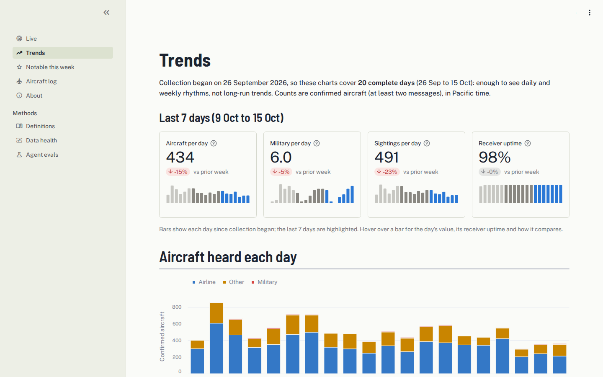
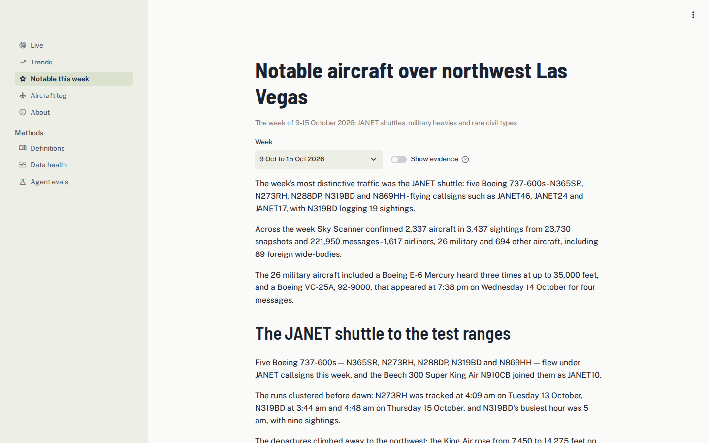
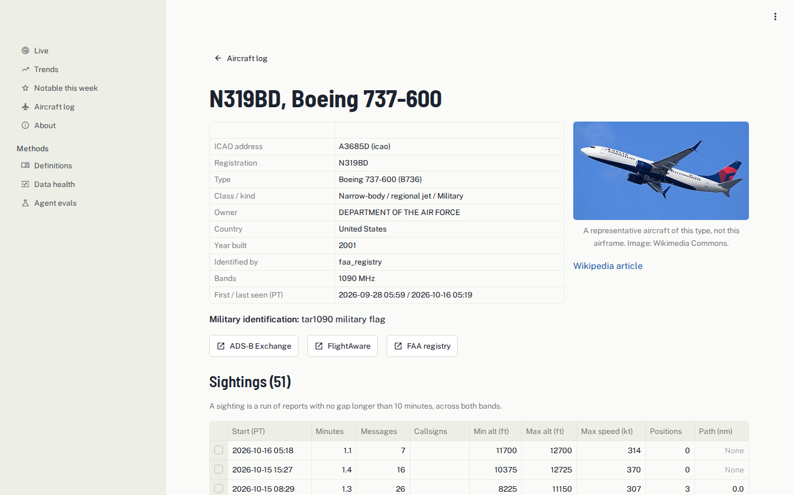

# Sky Scanner

A software radio in a window in northwest Las Vegas listens to aircraft
transponders on 1090 and 978 MHz. Its observations stream into BigQuery,
where dbt turns them into tested, documented definitions: what counts as an
aircraft, a sighting, "military", "identified". A public website, an MCP
server for AI agents and a weekly AI-written report all read the same
definitions, and data-quality checks email the operator when something breaks.

- **Website:** [skyscanner.pharrhomelab.com](https://skyscanner.pharrhomelab.com)
- **MCP server:** `https://mcp.skyscanner.pharrhomelab.com/mcp` (Streamable HTTP; no sign-in except
  for `run_sql`, which needs a token)



## What it shows

**One definition per number.** Every metric on the site is defined once in
dbt, tested on every build and exported with its description. The website's
Definitions page and the MCP server's `get_definitions` tool serve the same
text, so a person and an agent asking "how many aircraft were heard?" get
the same answer.

**Data quality that alerts.** dbt rebuilds hourly and checks source freshness
every 15 minutes on Cloud Run. Failures become structured log lines, which
log-based alert policies turn into email. Results land in BigQuery and drive
the Data health page.

**Permissions enforced by the warehouse.** The website, the MCP server and the
agent each run as their own service account, and each can read only the
`public` dataset: authorized views over the marts. Private owners are never
named, and aircraft on the FAA's LADD list or using privacy addresses are
flagged. Tests fail the build if a private owner's name reaches a public view.

**AI access with evals.** The MCP server exposes 19 tools over the public
views and serves the dbt definitions and column docs, so agents work from
the same meanings as the website. Every Monday an agent
(MiMo-V2.6-Pro through OpenRouter) investigates the week through those tools
and writes the [Notable aircraft](https://skyscanner.pharrhomelab.com/notable)
page. A verifier checks every number, time and name against the tool output
the agent cited and removes sentences that do not match. Evaluations on a
fixed week measure Q&A accuracy against gold SQL (15/15) and coverage of a
hand-written reference report (76%); results are on the
[Agent evals](https://skyscanner.pharrhomelab.com/evals) page.

| Notable aircraft, written by the agent | One aircraft and its sightings |
|---|---|
|  |  |

## Architecture

```
HOME (edge/)                                   GOOGLE CLOUD (infra/terraform)
HackRF ─▶ receiver ─▶ ingest ─▶ Postgres ◀─ enrichment (FAA, tar1090-db, OpenSky,
                                   │                     plane-alert-db, Wikipedia)
                             replicator ── streaming inserts, ~30 s ──▶ BigQuery raw
                                                                          │
          Cloud Scheduler ─▶ Cloud Run job: dbt (hourly build, freshness every 15 min)
                                                                          ▼
                                     analytics: staging → intermediate → marts
                                                                          ▼
                                     public: authorized views (owners masked, LADD/PIA flagged)
                                        │                      │                 ▲
                  Streamlit website ◀───┘                      └──▶ MCP server ──┤
                  (Cloud Run)                                       (Cloud Run)  │
                                                                         ▲       │
          Cloud Scheduler (Mon) ─▶ Cloud Run job: notable agent ── MCP ──┘       │
                                   (OpenRouter) → verifier → ai.notable_editions ┘

          dbt logs ─▶ log-based alert policies ─▶ email
```

## Repository

| Directory | What it is |
|---|---|
| [edge/](edge/README.md) | The receiver, decoders, ingestion, enrichment, local Postgres and the BigQuery replicator, run with Docker Compose at home |
| [dbt/](dbt/) | Staging, intermediate, mart and public models; tests; MetricFlow semantic models and metrics; column docs generated from one table |
| [jobs/dbt_runner/](jobs/dbt_runner/) | Runs dbt on Cloud Run, logs failures for alerting and stores run results |
| [services/web/](services/web/) | The Streamlit website |
| [services/mcp/](services/mcp/) | The MCP server (Streamable HTTP on Cloud Run, or stdio locally) |
| [jobs/notable/](jobs/notable/) | The weekly agent, its verifier and its evals |
| [infra/](infra/) | Bootstrap script, access-tier check and Terraform for every cloud resource |
| [docs/](docs/PLAN.md) | The build plan, with decisions and results for each phase |

## Running it

Each component has its own `requirements.txt` and tests
(`python -m unittest discover -s tests`). Linting is shared: `ruff` for
Python (`pyproject.toml`), `sqlfluff` for the dbt SQL (`dbt/.sqlfluff`) and
`terraform fmt`, pinned in `requirements-lint.txt` and run in CI with the
tests.

- **Edge:** see [edge/README.md](edge/README.md).
- **dbt:** `dbt build --profiles-dir .` from `dbt/` with Google credentials;
  the `dev` target writes to `dev_analytics` and `dev_public`.
- **Website:** `streamlit run app.py` from `services/web/`
  (`PUBLIC_DATASET=dev_public` to read dev).
- **MCP server:** `python server.py` from `services/mcp/` speaks stdio, for a
  local MCP client; `MCP_TRANSPORT=http` serves Streamable HTTP.
- **Cloud:** `infra/bootstrap.sh` once, then `terraform apply` from
  `infra/terraform/`.

## Data sources

The FAA aircraft registry (public domain), [tar1090-db](https://github.com/wiedehopf/tar1090-db),
the [OpenSky aircraft database](https://opensky-network.org/data/aircraft),
[plane-alert-db](https://github.com/sdr-enthusiasts/plane-alert-db) (ODbL),
[VRS standing data](https://github.com/vradarserver/standing-data) (CC0),
[War Watch Intel](https://www.warwatchintel.com/codex), ICAO Doc 8643 type
designators via OpenSky, and type photos from Wikimedia Commons, credited on
the site. Aircraft positions are received directly over the air.

## License

The code is under the [MIT License](LICENSE). Data sources keep their own
licenses, listed above.
